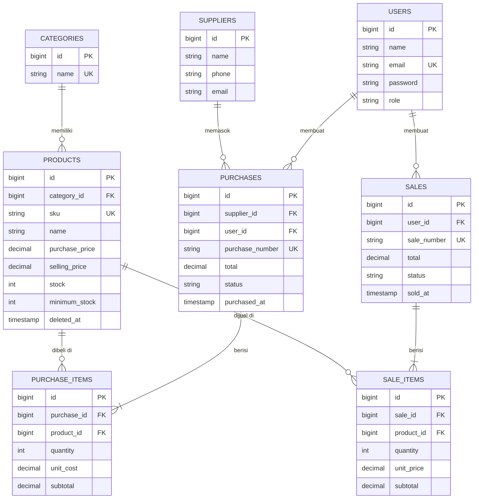
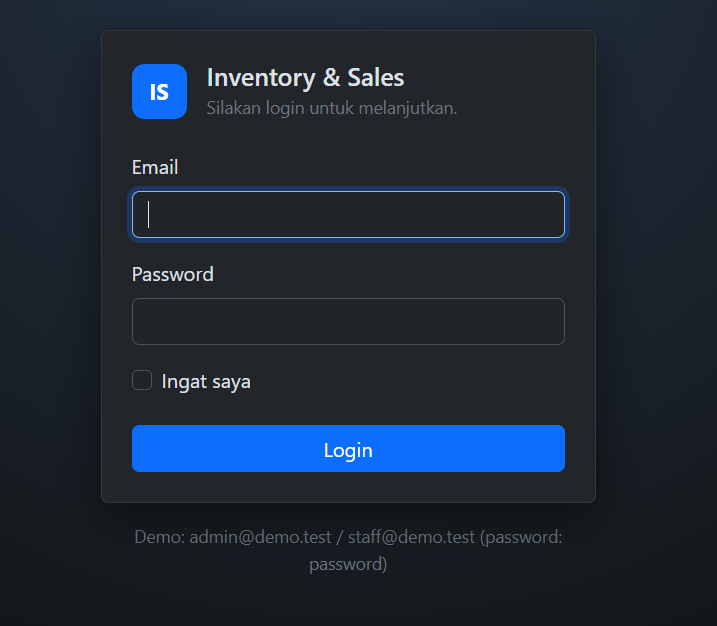
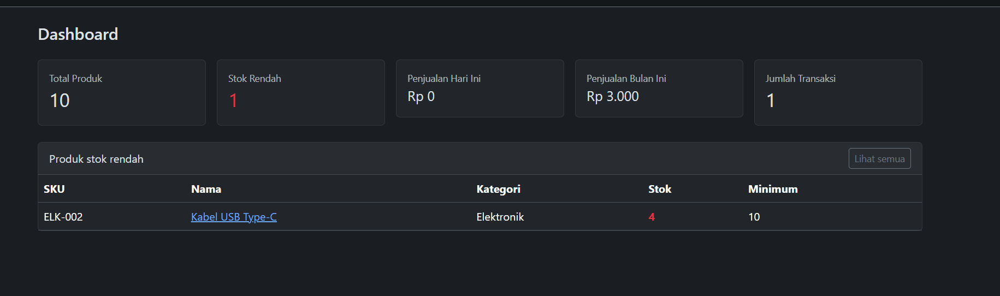
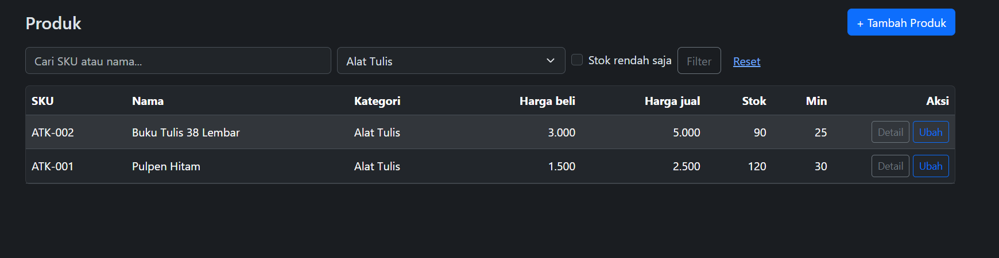
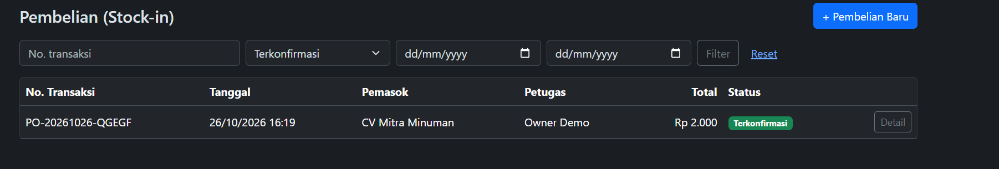
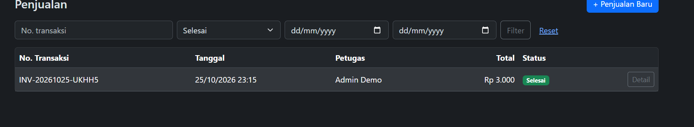
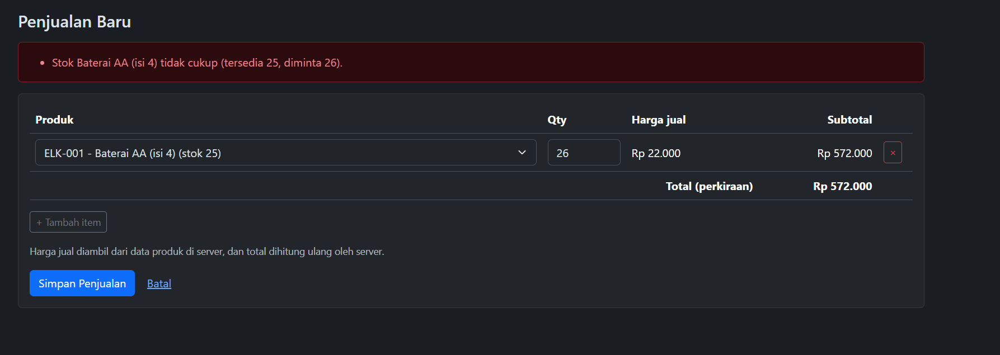
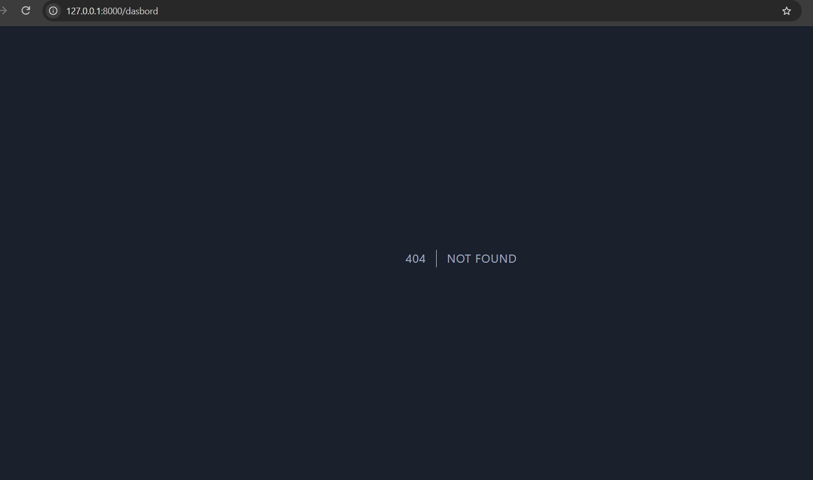
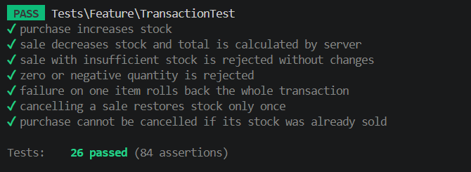

# Inventory & Sales Management System

Aplikasi manajemen inventaris dan penjualan berbasis **Laravel 10** dan **MySQL** (UTS Web Programming 2).
Mencakup login dan role (Admin/Staff), master data, pembelian (stok masuk), penjualan (stok keluar),
pembatalan transaksi, dashboard, serta pencarian, filter, dan pagination.

## Daftar isi
1. [Fitur](#fitur)
2. [Kebutuhan sistem](#kebutuhan-sistem)
3. [Instalasi](#instalasi)
4. [Akun demo](#akun-demo)
5. [Hak akses](#hak-akses)
6. [Aturan bisnis](#aturan-bisnis)
7. [ERD](#erd)
8. [Menjalankan test](#menjalankan-test)
9. [Test case manual](#test-case-manual)
10. [Screenshot](#screenshot)
11. [Batasan](#batasan)

## Fitur
- Login/logout, role **Admin** dan **Staff**, otorisasi di sisi server (Gate + middleware `can:`)
- CRUD Kategori, Pemasok, Produk (SKU unik, soft delete, stok minimum)
- Pembelian: stok bertambah, total dihitung server
- Penjualan: harga dari database, cek stok, anti-overselling (`lockForUpdate`)
- Seluruh simpan transaksi memakai `DB::transaction` (all-or-nothing)
- Pembatalan transaksi (Admin) dengan pemulihan stok yang konsisten dan tidak bisa dua kali
- Dashboard: total produk, stok rendah, penjualan hari ini dan bulan ini, jumlah transaksi
- Search, filter (kategori, status, tanggal, stok rendah), dan pagination yang mempertahankan query
- Manajemen pengguna (Admin): tambah dan ubah role/password

## Kebutuhan sistem
PHP >= 8.1, Composer, MySQL/MariaDB, ekstensi PHP `pdo_mysql` (dan `pdo_sqlite` untuk menjalankan test).

## Instalasi
```bash
git clone https://github.com/maulidingg317-dev/iventory-sales.git inventory-sales
cd inventory-sales
composer install
copy .env.example .env        # Linux/Mac: cp .env.example .env
php artisan key:generate
```
Buat database kosong `inventory_sales`, lalu ubah bagian database di `.env`:
```
DB_CONNECTION=mysql
DB_HOST=127.0.0.1
DB_PORT=3306
DB_DATABASE=inventory_sales
DB_USERNAME=root
DB_PASSWORD=
```
Jalankan migration dan seeder, lalu server:
```bash
php artisan migrate:fresh --seed
php artisan serve
```
Buka http://127.0.0.1:8000. File `.env` tidak boleh di-commit (sudah ada di `.gitignore`).

## Akun demo
Akun ini hanya data seeder untuk demo (bukan kredensial asli).

| Role  | Email            | Password |
|-------|------------------|----------|
| Admin | admin@demo.test  | password |
| Owner | owner@demo.test  | password |
| Staff | staff@demo.test  | password |

## Catatan environment dan keamanan
- Project ini memakai **Laravel 10** (kompatibel PHP 8.1). Aset memakai CDN Bootstrap, jadi **tidak perlu** `npm install` / `npm run build`.
- Jika Composer versi baru menolak instalasi karena peringatan keamanan paket lama, jalankan
  `composer install --no-security-blocking`.
- Di lingkungan production set `APP_ENV=production` dan `APP_DEBUG=false` agar stack trace tidak tampil ke pengguna.
- Zona waktu diatur di `config/app.php` (`'timezone' => 'Asia/Jakarta'`) agar "penjualan hari ini" sesuai jam lokal.
- Kredensial hanya di `.env` (tidak di-commit). Repository hanya memuat `.env.example`.

## Hak akses
| Fitur | Admin | Staff |
|---|:--:|:--:|
| Dashboard dan ringkasan penjualan | ya | tidak (403) |
| Lihat produk dan daftar stok rendah | ya | ya |
| Tambah/ubah/hapus produk, kategori, pemasok | ya | tidak (403) |
| Buat pembelian dan penjualan | ya | ya |
| Lihat transaksi | semua | hanya miliknya |
| Batalkan transaksi | ya | tidak (403) |
| Kelola pengguna | ya | tidak (403) |

## Aturan bisnis
| Aturan | Lokasi di kode |
|---|---|
| SKU unik (validasi dan unique index database) | `ProductRequest`, migration `create_products_table` |
| Stok tidak boleh negatif | `unsignedInteger`, `SaleService::create` |
| Stok hanya berubah lewat transaksi (`stock` tidak fillable) | `Product::$fillable` |
| Total dan harga jual dihitung server | `SaleService`, `PurchaseService` |
| Transaksi atomik, rollback jika gagal | `DB::transaction` di kedua service |
| Anti-overselling | `Product::lockForUpdate()` di `SaleService` |
| Transaksi selesai tidak bisa diedit, hanya dibatalkan | route hanya `index/create/store/show` + `cancel` |
| Pembatalan memulihkan stok sekali saja | `lockForUpdate` pada header transaksi + cek status |
| Pembatalan pembelian ditolak bila stok sudah terpakai | `PurchaseService::cancel` |
| Produk yang sudah dipakai transaksi tidak bisa dihapus | `Product::hasTransactions`, `ProductController::destroy` |
| Kategori/pemasok yang masih dipakai tidak bisa dihapus | `CategoryController`, `SupplierController`, FK `restrictOnDelete` |
| Staff hanya melihat transaksi miliknya | Gate `view-transaction`, filter di controller index |

## ERD

Kunci asing berada di tabel detail (`*_items`) karena satu transaksi memiliki banyak item (sisi "banyak" menyimpan FK).

## Menjalankan test
Test memakai SQLite in-memory agar database MySQL asli tidak tersentuh. Pastikan dua baris berikut di
`phpunit.xml` **tidak** dikomentari:
```xml
<env name="DB_CONNECTION" value="sqlite"/>
<env name="DB_DATABASE" value=":memory:"/>
```
Lalu jalankan:
```bash
php artisan test
```
`tests/TestCase.php` menghentikan test otomatis bila koneksi bukan sqlite (pengaman agar data asli tidak terhapus).

## Test case manual
| No | Skenario | Hasil yang diharapkan |
|---|---|---|
| 1 | Buka `/dashboard` tanpa login | Diarahkan ke `/login` |
| 2 | Login dengan password salah | Pesan "Email atau password salah." |
| 3 | Staff membuka `/users` lewat URL | 403 |
| 4 | Tambah produk dengan SKU yang sudah ada | Ditolak, pesan SKU sudah dipakai |
| 5 | Tambah produk dengan harga negatif | Ditolak |
| 6 | Pembelian 10 unit produk X | Stok X bertambah 10 |
| 7 | Penjualan 3 unit produk X | Stok X berkurang 3, total = 3 x harga database |
| 8 | Penjualan melebihi stok | Ditolak, stok dan data transaksi tidak berubah |
| 9 | Penjualan 2 item, item kedua stok kurang | Seluruh transaksi gagal, stok item pertama tetap |
| 10 | Admin membatalkan penjualan | Stok kembali; membatalkan lagi ditolak |
| 11 | Batalkan pembelian yang stoknya sudah terjual | Ditolak dengan pesan jelas |
| 12 | Hapus kategori/produk yang sudah dipakai | Ditolak |
| 13 | Cari produk, filter kategori/stok rendah, pindah halaman | Hasil sesuai, query tetap terbawa |
| 14 | Staff membuka detail transaksi milik Admin | 403 |

## Screenshot

### Login


### Dashboard


### Produk


### Transaksi




### Aturan bisnis dan otorisasi



### Hasil pengujian
